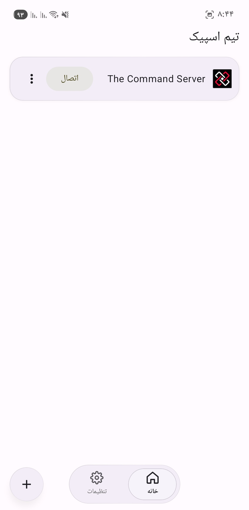
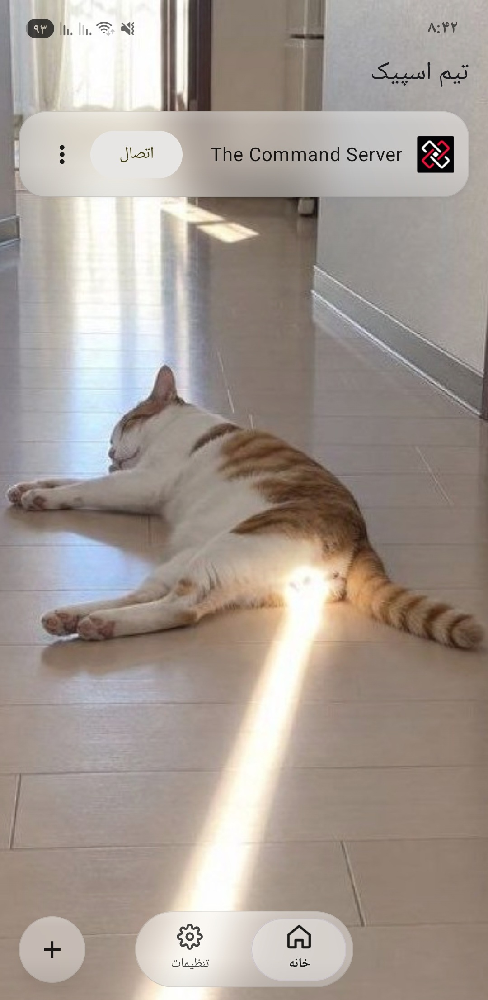
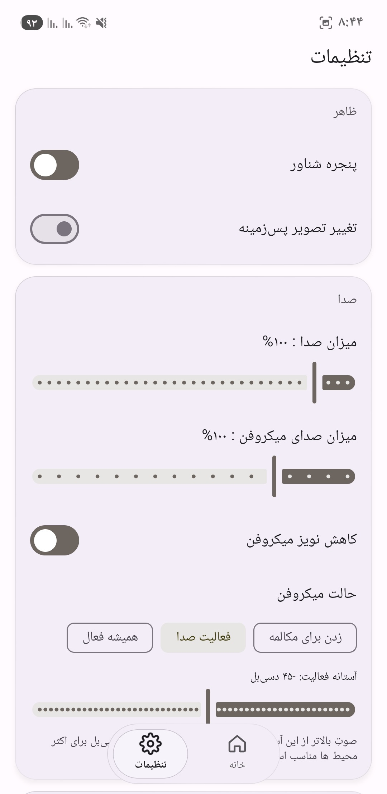
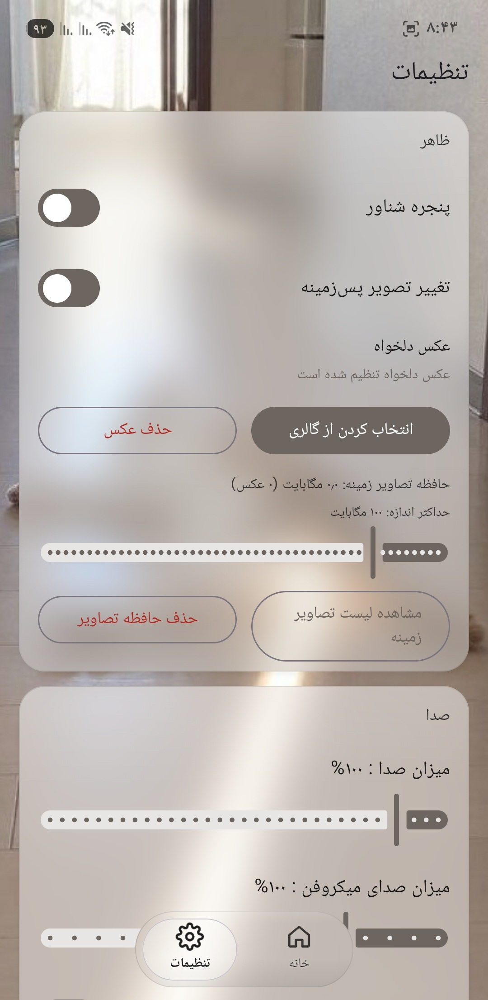
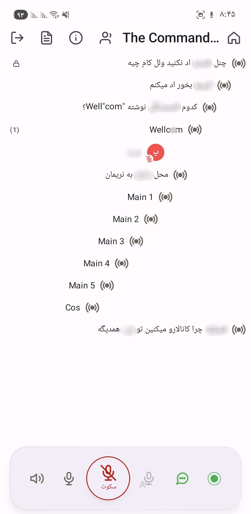
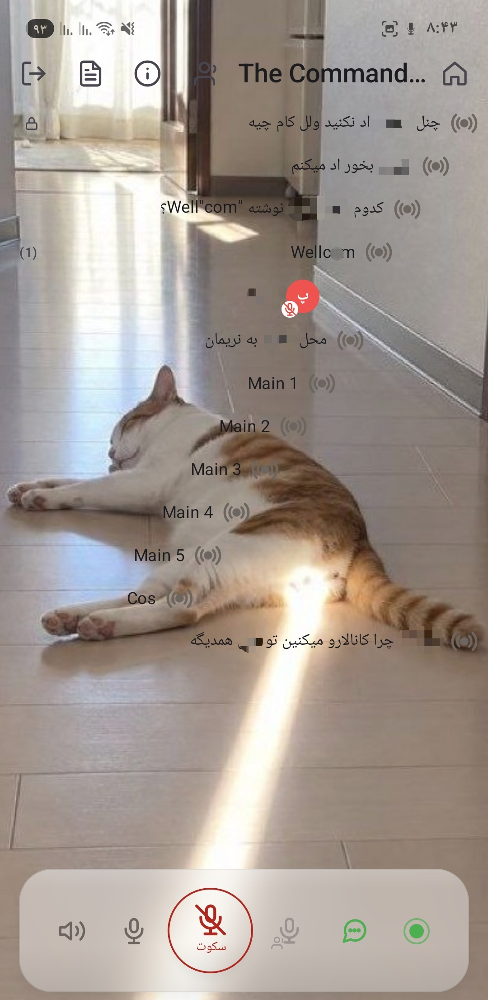
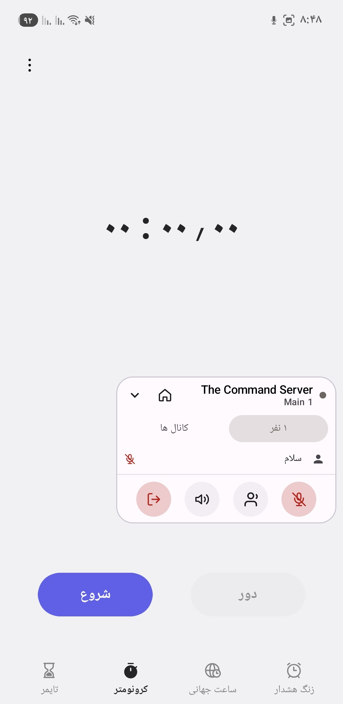
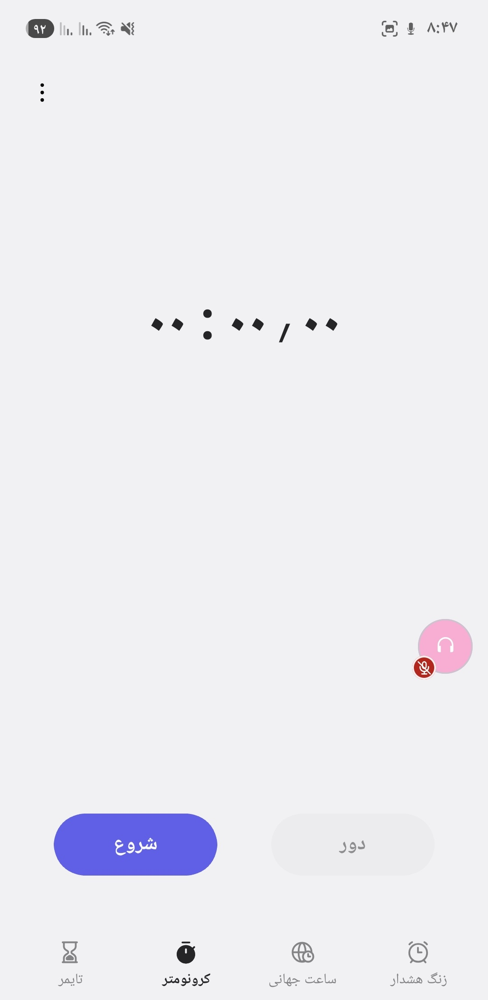

# TS6 Droid Persian Edition (defaulting to English)

An Android client localized into Persian (Farsi), based on the Simplified Chinese fork from [YUAXI/TS6_Droid_CN](https://github.com/YUAXI/TS6_Droid_CN) which is enhanced with additional features, forked from original author's open-source project [flamme-demon/TS6_Droid](https://github.com/flamme-demon/TS6_Droid).

A free, lightweight TeamSpeak 3/6 Android client built with Jetpack Compose and powered by the Rust-based `tslib` underneath.

---

## Project Showcase

<div align="center">
<table>
  <tr>
    <td align="center"><a href="img/screenshow1.jpg"></a></td>
    <td align="center"><a href="img/screenshow2.jpg"></a></td>
  </tr>
  <tr>
    <td colspan="2" align="center"><sub>Home (Custom Background Disabled / Enabled)</sub></td>
  </tr>
  <tr>
    <td align="center"><a href="img/screenshow3.jpg"></a></td>
    <td align="center"><a href="img/screenshow4.jpg"></a></td>
  </tr>
  <tr>
    <td colspan="2" align="center"><sub>Settings (Custom Background Disabled / Enabled)</sub></td>
  </tr>
  <tr>
    <td align="center"><a href="img/screenshow5.jpg"></a></td>
    <td align="center"><a href="img/screenshow6.jpg"></a></td>
  </tr>
  <tr>
    <td colspan="2" align="center"><sub>Server (Custom Background Disabled / Enabled)</sub></td>
  </tr>
  <tr>
    <td align="center"><a href="img/screenshow7.jpg"></a></td>
    <td align="center"><a href="img/screenshow8.jpg"></a></td>
  </tr>
  <tr>
    <td colspan="2" align="center"><sub>Floating Window (Expanded / Collapsed)</sub></td>
  </tr>
</table>
</div>

<sub>Each row shows two side-by-side comparisons of the same screen. Click any image to view it in its original resolution.</sub>

---

## Changelog

### v2.1.9-Han (2026-10-30)

**New: Persian (Farsi) Localization**

- Added Persian as a selectable app language, with translations across the app and Persian-matched screenshots.
- English is now the default language for new installations instead of Simplified Chinese.
- Improved the Android display name and Persian wording in several places, and uses "AndroidUser" when no default nickname is supplied.

**App Identity Updates**

- Changed the application ID to `com.app.ts6droid` to make this edition install separately from other TS6 Droid variants.
- Connected in-app update checks and release links to this repository.
- Some basic link changes to point the app to this fork.

**Documentation**

- Translated the README and Actions workflow messages into English.

### v2.1.8-Han (2026-10-20)

**New: Online / Away / Do Not Disturb (Desktop-style status menu)**

- Added a **status indicator** at the far left of the bottom bar (green = Online, amber = Away, red = Do Not Disturb). Tap it to open the status menu.
- **Online**: Clears the away flag and away message.
- **Away**: Sets the away flag and away message. The microphone remains available as usual.
- **Do Not Disturb**: On top of the Away status, **disables the microphone**. Push-to-talk, push-to-whisper, and continuous transmission can no longer activate the microphone.
  Switching back to Online or Away restores the current microphone mode.
- **Custom away message**: Enter a message directly in the menu (up to 100 characters). Leave it empty to use the default text (Away / Do Not Disturb).
- The panel opened by **long-pressing your own row** now includes a "Status" row and an "Edit Status" button.
- The panel opened by **long-pressing any member** now includes "Status" and "Away Message" rows.
- The selected status is automatically restored after reconnecting from a disconnection. It only resets to Online when you disconnect manually.

**Fixes**

- **Status changes not appearing on other clients**: A status change now sends only one command. Rapid taps are merged, and a minimum interval is enforced between commands. This prevents the server's flood protection (`client is flooding`) from discarding commands. If rate-limited, the command is automatically resent once after 10 seconds.
- **Unable to enter passwords for password-protected channels in the floating window**: The window is temporarily allowed to gain focus when the password field opens, allowing the keyboard to appear. Focus is restored to its previous state immediately after closing (the window was previously non-focusable, preventing the input method from appearing).
- **Microphone mute state**: Updates are now reported only when the state actually changes, and share the minimum command interval with status commands. Rapid push-to-talk presses and releases no longer trigger the server's flood protection.

**Under the Hood**

- New patch for `tslib_multi` 8e0bc11:
  [`patches/tslib_multi-8e0bc11-away-status.patch`](patches/tslib_multi-8e0bc11-away-status.patch)
  (applied on top of the v2.1.7 whisper patch): Adds `set_away` to `tslib-core` and `nativeSetAway` to `tslib-jni`.
  - The patch uses LF line endings in the repository. If applying it on Windows in a workspace with `core.autocrlf=true` results in a `different line endings` error, run `dos2unix` on the patch file first (or use `patch --binary`).
- Recompiled the native library for arm64-v8a using cross-compilation (`--features vendored-openssl`).
- Unit tests increased from 75 to 79.

### v2.1.7-Han (2026-10-19)

**Whisper — Desktop-style voice whispering is back**

Whisper was removed in v2.1.5 because the previous implementation could only send text-based private messages. Voice whispering requires the underlying `tslib` to wrap captured audio packets into `C2SWhisper` packets, but the bundled native library did not provide this interface. This update switches to a native library with whisper support (built from `tslib_multi` 8e0bc11) and completes the UI and state machine:

- **Voice is sent only to the targets (routing is activated only while holding the button)**: The whisper list itself does **not** keep the microphone permanently routed to whisper targets. Voice continues to be sent to the current channel by default. Only packets captured while **holding the Whisper button** are wrapped into whisper packets by the native layer and sent to the selected targets (a client, an entire channel, or an entire server group). Releasing the button immediately restores normal channel transmission. This keeps the two microphone buttons in the bottom bar semantically separate: the regular microphone sends to the channel, while the whisper microphone sends to the list.
- **Two Push-to-Whisper microphones**: Added an amber microphone with a whisper indicator to the left of the main microphone in the bottom bar. The same button is also available in the floating window panel. **Hold to speak and whisper immediately**, without switching modes first. If the list is empty, the app prompts you to add targets instead of silently doing nothing.
  While the button is held, **routing is switched before the microphone is enabled** (the native target set is prepared first), so the beginning of a sentence cannot leak into the channel. On release, the microphone is disabled before the routing is cleared. The microphone mode active before pressing the button (voice activation, continuous transmission, or push-to-talk) is restored exactly as it was.
- **Server-group whispering (native protocol routing)**: `tslib` now supports group targets through `set_whisper_targets`, which accepts `groups: Vec<u64>` and sends **server-group whisper packets** according to protocol 1.8.2.1 (`VoiceWhisper` + `Newprotocol` flag + `GroupWhisperType::ServerGroup` + `GroupWhisperTarget::AllChannels`). **The server resolves the group members**.
  As a result, an entire group counts as a single target. **Members who join the group later can hear whispers immediately**, and member joins, leaves, group changes, and reconnects do not require the app to resend the target list. The group also does not need to be expanded into a client list, which would be subject to the client's target limit.
- **Server group names**: After establishing a connection, the native layer sends `servergrouplist` to the server. The group-name list is returned through `nativeGetServerGroups()`, allowing the whisper list to display actual group names (falling back to `Server Group #id` when names are unavailable).
- **Member server groups are visible**: The panel opened by long-pressing any member (**including your own row**) now includes a "Server Groups" section, listing the groups the member belongs to using the names returned by the server. If a group name is unavailable, it displays `Server Group #id`. If there are many groups, this section scrolls independently.
  Your own row only displays identity and group information. Actions that have no meaning for yourself, such as volume, mute, private messages, and whisper, are hidden.
- **Member channel groups are visible**: The same panel also includes a "Channel Groups" row, showing the channel groups the member holds in the current channel.
  Group names come from the server's `channelgrouplist` (requested by the native layer during connection and refreshed when the panel opens). If a name is unavailable, it displays `Channel Group #id`. If the group ID cannot be retrieved (0), the entire row is hidden instead of displaying 0.
- **Whisper list panel**: Tap the whisper icon in the top bar to open the list editor, divided into three selectable sections: "Server Groups / Channels / Members". Group rows display the number of online members for reference only; group targets do not consume client target slots.
- **Whisper list controls**: Added a whisper button to the right of each member row (green = already in the list). The panel opened by long-pressing a member also includes a toggle.
  Long-press a channel row to add or remove the **entire channel** from the list. Channel rows already in the list display a green whisper indicator.
- **Target entry limit: 10**: The limit applies to whisper entries, based on the server's `virtualserver_maxwhisperclients` default value. Each client, channel, or server group counts as one entry. The panel displays a warning when the limit is exceeded instead of silently failing.
- **UID-based storage**: Whisper targets and private conversations share the same conversation key (`PrivateConversations.keyFor`). Targets remain valid after the other user reconnects. **The list is automatically resent after an automatic reconnect**, so there is no need to select everything again.
- **No leakage when targets are offline**: When all targets are offline, a "discard sentinel" (client 0) is sent. The server directly discards whisper packets.
  It never falls back to channel broadcasting, which would otherwise mean that the UI says whisper while the entire channel can hear the audio.
- **Whisper indicators**: A green whisper icon in the top bar (when a list is configured); a "Whisper List: ..." banner above the chat input and matching placeholder text; the user's avatar gets an **amber** halo while holding the whisper button (the floating-window bubble border also turns amber). When someone whispers to you, a notification appears once, with a 15-second debounce interval.
- **Text sent to the list**: When the whisper list is non-empty, typed messages are sent as private messages to every online target (for group targets, to their currently online members) and are also saved to the corresponding private conversations. Channel targets receive voice only (TS3 has no text command addressed to an arbitrary channel).

**New: Change Your Temporary Nickname Within a Channel**

Long-press your own row → "Change Temporary Nickname" at the bottom of the panel → Enter a new nickname (validated using the same 3–30 character rules as the connection screen) → The change takes effect immediately through `clientupdate client_nickname`, and the member list displays the new nickname.

- **Only applies to the current connection**: Does not modify the identity file. After reconnecting, the nickname reverts to the one used when connecting.
  The native layer stores the updated nickname in memory as a local override. The server does not echo `clientupdate` back to the sender; otherwise, the member list would display the old name.
- If the server rejects the nickname (duplicate name or invalid characters), the server's error message is displayed as usual.

**Additional Fix: Unable to Join Password-Protected Channels**

Previously, clicking a password-protected channel would only result in a rejection from the server. The UI showed no prompt and did not switch channels, making it look as though nothing happened.
(The native `moveToChannel(channelId, password)` function already existed; the missing part was the client-side entry point.)

- Channel rows now display a **lock icon**, so you can tell that a password is required before clicking.
- Clicking the channel opens a **password input dialog** (glass-style dialog with masked input). Confirming enters the channel with the supplied password.
- The password is **not saved** and is used only for that join attempt. An incorrect password is still reported through the server's error message.
- **The floating window's channel list supports this as well**: It uses inline password input and a lock icon. The floating window is a `WRAP_CONTENT` window, so full-screen dialogs would be clipped. Inline input is used here instead of a dialog.

**Under the Hood**

- The native library is based on `tslib_multi` 8e0bc11 (this commit is not on upstream main; it is a personal commit used for CI builds). It was **cross-compiled independently after applying custom patches**.
  See [`patches/tslib_multi-8e0bc11-whisper-groups.patch`](patches/tslib_multi-8e0bc11-whisper-groups.patch).
  The patch applies cleanly to 8e0bc11 with `git apply`. It adds group whisper packet transmission (`whisper_groups`), `set_nickname` (`clientupdate client_nickname` + local override), `servergrouplist` / `channelgrouplist` requests and group-name retrieval to `tslib-core`, and adds `nativeGetServerGroups`, `nativeGetChannelGroups`, `nativeSetNickname`, and the three-argument `nativeSetWhisperTargets` to JNI.
  The included 6 unit tests verify the byte layout of group whisper packets and the routing rule that prevents falling back to channel broadcasting when all targets are offline, based on the protocol documentation.
- Rebuilt using WSL + Linux NDK r27c + cargo-ndk (`ANDROID_NDK_HOME` points to the NDK):
  `cargo ndk -t arm64-v8a --platform 29 -o <out> build --release -p tslib-jni --features vendored-openssl`
  (`vendored-openssl` is required: `reqwest` / `native-tls` pulls in `openssl-sys`.)
- Also includes interfaces such as `nativeSetWhisperTargets`, `nativeSetAudioSink`, `nativeWaitEvents`, `nativeSendPoke`, and `nativeGetNetworkStats` (only the interfaces required for whispering were integrated in this update).
- **Fixed two JNI signature mismatches**:
  `nativeMoveToChannel` now includes a channel password parameter, and `OpusCodec.nativeDecode` now includes an FEC parameter. Without the former, it would read a non-existent parameter; without the latter, a garbage value could be passed to the native layer as a flag.
- Voice reception is now **push-based**: The native layer calls `AudioBridge` directly for each packet (this is also the only place where whisper packets can be distinguished from channel packets). The event-based `audio_received` playback path has therefore been removed to prevent duplicate playback.
- Unit tests increased from 46 to 75 (whisper target lists and routing, group target forwarding, conversation keys, server/channel group names, and nickname rules).

### v2.1.6-Han (2026-10-17)

> This update references the project [wslinnn/TS6_Droid_CN](https://github.com/wslinnn/TS6_Droid_CN).

**APK Size: 71.7 MB → 14.9 MB**

- Enabled R8 code shrinking and resource shrinking, and archived `mapping.txt` to allow obfuscated crash stack traces to be deobfuscated. Previously, release builds never ran R8, so approximately 11,400 unused Material icon classes were bundled into the APK (DEX size reduced from 58.3 MB to 3.2 MB).

**Security and Privacy**

- **Attachment channel validation**: The `channel` parameter in `ts3file://` links is taken directly from message text. Previously, anyone could send a crafted message and make the client retrieve files from **any channel**. The channel is now checked for existence first.
- **Inline images now respect the setting**: `[img]` tags and image links in chat previously **bypassed** the "Automatically Load Images" setting and loaded unconditionally, potentially exposing the local IP address to a server specified by the sender. They now respect this setting (disabled by default) and require a click to load.
- Share-link parameters are now URL-encoded (filenames containing Chinese characters, spaces, `&`, etc. no longer break links).
- Files with the same name in different channels no longer share the same cache entry.
- Filtering system notifications no longer accidentally discards user messages containing the same text.
- **Cloud backups / device migration** now exclude bookmarks (which contain plaintext server passwords) and chat history. Previously, only identity private keys were excluded.
- **Signing passwords are no longer stored in build scripts**: They are now read from environment variables or a local `keystore.properties` file (see [Build Signing Instructions](#multi-computer-build-signing-instructions)).

**Stability**

- Messages with identical millisecond timestamps no longer cause crashes due to duplicate LazyColumn keys.
- File uploads now **check file size before reading**. Files larger than 10 MB are rejected immediately instead of being fully loaded into memory and causing an OOM.
- Chat history is now parsed using `org.json`. Previously, the handwritten scanner would **silently discard the affected message and all subsequent history** when encountering text containing `\"`.
- Messages are now removed locally only when the server rejects them. Previously, any failed command could mistakenly delete a message that had already been sent successfully.
- Speaking indicators no longer get stuck permanently; messages arriving immediately after connection are no longer lost.
- Avatar downloads, image-preview decoding, and file-upload reads have been moved off the main thread. Removed excessive `PermCheck` debug logging.
- When the server transfers an APK in chunks without providing the total size, the update progress no longer incorrectly gets stuck at 100%.

**Voice**

- **Voice-activated microphone**: Microphone mode now offers three options: "Push-to-Talk / Voice Activation / Continuous Microphone". Voice activation supports thresholds from −70 to −15 dB, with built-in hysteresis, release delay, and pre-send buffering (so the beginnings and endings of words are not cut off).
- **Microphone gain: 0–400%** (0% effectively mutes the microphone), addressing the issue of other users hearing your voice too quietly.
- **Per-user volume**: Long-press a member to open a panel where you can adjust their volume individually, mute them, or send them a private message. Settings are persisted by UID and remain effective across sessions.
- **Audio focus and echo cancellation**: Automatically yields audio focus when another application takes exclusive audio focus, such as during an incoming call or navigation announcement. If audio ducking is supported, the volume is reduced to 30%. Volume is automatically restored when the interruption ends, without requiring a reconnect. AEC is automatically enabled when supported by the device, preventing your speakers' audio from being echoed back to other users.
- Output gain now includes a soft limiter, preventing hard clipping when gain is increased.
- The playback wake-up frequency during silent periods has been reduced from 50 times per second to 4 times per second, lowering idle power consumption without affecting playback startup latency.
- If low-latency audio track initialization fails on certain devices, the app automatically recreates it without `PERFORMANCE_MODE`, instead of remaining silent.

**Networking**

- **Immediate reconnection when switching between Wi-Fi and cellular networks**: Previously, the app had to wait for the heartbeat timeout, resulting in several seconds of silence. It now reconnects as soon as the platform reports a new network, without waiting for the initial retry backoff. Also added the missing `ACCESS_NETWORK_STATE` permission (without it, the callback would never be delivered).

**Features**

- **Identity Export / Import** (Settings → Identity): View the identity UID, export `identity.ini`, and import another user's identity. The identity is validated before import and replaced atomically, so a failed import does not affect the existing identity. **This is the only way to preserve server permissions when switching devices** (identity private keys are excluded from cloud backups).
- **Private conversations grouped by UID**: Conversations are now grouped by the other user's UID. Reconnecting no longer splits the same person into multiple conversation tabs. Unread badges are persisted along with chat history, and old data is migrated automatically.
- **Server information card**: An information button in the server page's top bar opens a card displaying the server name, platform/version, online user count, channel count, uptime, and welcome message.
- **Crash report overlay**: After an unexpected exit, the next launch displays the stack trace and provides a one-tap copy action (making troubleshooting possible without adb).
- **In-app log viewer** (Settings → More → Diagnostic Logs): Reads the current app process logs, including native `tslib` output. Supports refreshing, one-tap copying, and clearing.
- Update notes are now rendered as Markdown.
- **Frosted glass material improvements**: The panel opened by long-pressing a member previously used Material's `ModalBottomSheet` (a separate window without wallpaper available to blur, so it could only display as an opaque surface). It now uses an in-app-drawn frosted glass panel while retaining the swipe-down-to-dismiss gesture.
- Added `Info` and `Server` icons to `AppIcons`; the home server list now uses the new server icon.
- **Server addresses are no longer displayed on the home screen**, preventing server IPs and domains from being exposed in screenshots.

**Engineering**

- Added **46 unit tests**, which run automatically before CI builds.
- Added a signed release workflow: Pushing a `vX.Y.Z-Han` tag automatically validates the version, runs tests, signs and packages the APK using repository Secrets, verifies the APK signature, archives `mapping.txt`, calculates SHA-256, and creates a Release.
- Disabled Jetifier and removed duplicate permission declarations.
- File-size units are now localized (previously hardcoded French `Ko/Mo/Go`).

### v2.1.5-Han (2026-10-15)

**Frosted Glass Material**

- Unified cards, bottom bars, dialogs, menus, and input panels under a frosted glass material. All are drawn directly within the app (new `GlassDialog` / `GlassOverlayHost` / `GlassMenuItem` / `CompactTopBar`).
- Frosted glass now uses a single blurred copy of the wallpaper, baked and shared by all panels. The old refraction (SDF) pipeline has been removed.
- The frosted layer is clipped to each panel's dimensions during drawing, keeping the panel size and position consistent.
- Falls back to opaque surfaces when the anime background is disabled.
- Standardized the top bar to a compact layout (64dp → 48dp).
- "I'm a Weeb" (anime background) is disabled by default.

**Custom-Drawn Icon Set**

- Added `AppIcons` (24×24 viewport, 2-unit rounded strokes, 10 icons in total), replacing scattered Material icons throughout the UI.

**UI Adjustments**

- Changed the About page to a pure white background and locked it to the light theme.
- Moved "About" in Settings to the end of the "More" section.
- Removed the Whisper feature.

**New Features**

- **Floating window redesigned**: Only appears when the app is in the background and automatically hides when the app returns to the foreground.
  - The bubble displays the app icon or the current speaker's avatar. It can be dragged and snapped to the screen edges. Long-press it to use push-to-talk. Unread and mute badges appear in the bottom-right corner.
  - The panel includes "Members / Channels" views, microphone and audio controls, and a disconnect option. The ⌂ button in the header returns to the app. Expand/collapse transitions are animated.
- **Swipe horizontally to switch screens**: Home ↔ Settings, and Chat panel Channels ↔ Private Messages.
- **Return to the home screen without disconnecting**: After connecting, press the Back button or tap the home icon in the top bar to return home. A "Session in Progress" pill on the right side of the top bar takes you back to the session with one tap.
- **Export wallpaper cache to gallery**: Save images individually or export all of them.
- **Persist Push-to-Talk / Voice Activation modes**.
- **Automatic reconnection after disconnection**: Uses exponential backoff and returns to the original channel after reconnecting.
- Added "Battery Optimization Whitelist" and "App Permissions & Auto-start" shortcuts to Settings.
- Displays warnings in the server-page banner, floating window, and notification when the microphone is unavailable.
- Added Chinese, English, and French translations.

**Performance Optimizations**

- On cold start, wallpapers are downloaded and decoded only once. Theme color extraction now uses `getPixels`, and the frosted-glass baking process reuses buffers.
- Language settings are preloaded in the background. Icon decoding and identity-file operations have been moved off the main thread. Notification channels are created only when needed.
- Wallpaper initialization time is now logged.

**Bug Fixes**

- Fixed lag when toggling the wallpaper.
- Fixed crashes when dragging, clicking, or expanding the floating window.
- Fixed slow floating-window expansion animations, clipped badges, and gray squares appearing outside buttons.
- Fixed chat bubble width and left/right alignment.
- Fixed cards displaying only outlines after disabling the anime background.
- Fixed inconsistent styling of the battery optimization whitelist row.
- Fixed the splash screen appearing before the wallpaper was ready.
- Automatically recreates the recording channel when the background microphone becomes unavailable.
- Fixed complete audio loss after running in the background for a long time (the capture coroutine is now owned by the audio bridge).
- Holds a `PARTIAL_WAKE_LOCK` while connected and adds a microphone watchdog.

### v2.1.4-Han (2026-08-18)

**Bug Fixes**

- **Nickname length validation**: Added a minimum nickname length check when connecting to a server. Nicknames must contain at least 3 characters (PR #4 from IMito-iron).
- Extracted `getValidatedConnectionInput()` to handle all pre-connection input validation in one place.
- Added the error message: "Nickname must be at least 3 characters" (available in Chinese, English, and French).

### v2.1.3-Han (2026-07-28)

**New Features**

- **TS3 Spacer channel rendering**: Parses `[cspacer]`, `[lspacer]`, `[rspacer]`, and `[*spacer]` tags so that the channel list correctly displays dividers and decorative text (PR #3 from XuVIIJay).

### v2.1.2-Han (2026-07-15)

**New Features**

- **Custom backgrounds**: Supports uploading images from the gallery as backgrounds, with cropping previews (pinch-to-zoom with two fingers + drag with one finger).
- Full-screen cropping preview with a rule-of-thirds grid and draggable corner handles.
- Added custom background management (upload/delete) to Settings.
- Custom backgrounds take effect immediately after saving, without requiring a restart.

**UI Refactoring**

- Reorganized Settings into a card-based layout: Appearance, Audio, Chat, and More.
- Expanding the anime background toggle reveals a nested section (custom background + wallpaper cache).
- Language selection and About have been moved into the "More" section.
- The version number is displayed at the bottom of Settings.
- Settings cards are semi-transparent and do not obscure the anime background.

**Bug Fixes**

- Fixed the unusable cropping feature (the crop frame could only be moved, not resized).
- Fixed the issue where a restart was required for a saved custom background to take effect.

### v2.1.0-Han (2026-06-27)

**New Features**

- **In-app updates**: After checking for updates, the APK can be downloaded and installed directly within the app, without opening a browser.
- A progress bar displays the download percentage in real time. The system installation screen opens automatically when the download completes.
- Added a "Downloading" state. The dialog cannot be dismissed while downloading, and errors are displayed if the download fails.
- Added FileProvider support so that APKs downloaded within the app can be installed normally on Android 8+ devices.
- Added the `REQUEST_INSTALL_PACKAGES` permission declaration.

**Bug Fixes**

- Fixed version detection failing to recognize newer releases: The `-Han` suffix is now removed before comparing version numbers.
- Fixed failed API requests being incorrectly reported as "Already up to date". The app now displays the specific error message.
- Fixed crashes when a Release does not contain an uploaded APK. The app now falls back to the Releases page.

**Build Signing**

- Added a unified signing file, `release.keystore`, used for both debug and release builds.
- For collaboration across multiple computers, simply copy `release.keystore` to the project root on each machine.

### v2.0.5-Han (2026-06-27)

**Feature Fixes**

- Fixed the volume gain slider not taking effect after adjustment by adding a Flow observer to synchronize changes with the audio bridge in real time.
- Verified the microphone noise suppression implementation using Android's native NoiseSuppressor API and added logs to help troubleshoot device compatibility.
- Changed the logo background color from blue to pink (#2962FF → #FF69B4).
- Fixed in-app version checking failing to detect newer releases: The `-Han` suffix is now removed before comparing version numbers. API failures display an error message instead of incorrectly reporting that the app is up to date.
- Fixed GitHub API unavailability in mainland China being incorrectly displayed as "Already up to date".

**New Features**

- In-app version checking: Tap the version number in Settings to query the latest GitHub Release and display an update dialog.
- Displays specific error messages for network failures and "Already up to date" when no update is available.
- Automatically falls back to the GitHub Releases page when a Release does not contain an APK.

### v2.0.1-Han (2026-06-26)

**Compose Performance Optimizations**

- Migrated 54 Flow collectors throughout the project from `collectAsState` to `collectAsStateWithLifecycle`. UI collection now automatically pauses when the app moves to the background, reducing CPU usage and battery consumption.
- Migrated background-image fade-in animations from `Modifier.alpha()` to `Modifier.graphicsLayer {}`. Animation frames now skip the Composition-stage recomposition, reducing dropped frames.
- Added stable `key` values to the cached wallpaper grid, preventing the scroll position from jumping back when wallpapers are added or removed.

**Bug Fixes**

- Fixed the wallpaper cache viewer doing nothing. Tapping it now opens a thumbnail-grid dialog.
- Added a confirmation dialog before clearing the wallpaper cache.
- Fixed the volume gain slider in Settings.
- Fixed switches in Settings jumping and flickering when switching pages.
- Image files can now be opened in the file manager for full-screen in-app previews.

### v2.0.0-Han (2026-06-26)

**Complete Material3 UI Refactoring**

- Fully redesigned colors, typography, and component styles according to Google's Material Design 3 guidelines.
- Dynamic Color (Android 12+): Automatically extracts the theme color from the wallpaper image and generates a complete color scheme.
- 15-level typography system, with Shape corner-radius tokens aligned with the M3 standard.
- Unified M3 styling across all components (buttons, input fields, cards, dialogs, and bottom bars).

**Splash Screen and Adaptive Theme**

- Added a SplashScreen startup interface that displays the brand logo while loading.
- Automatically extracts the dominant color from the wallpaper after downloading it, with theme colors adapting in real time.
- 3-second timeout protection: If a network error occurs, a random wallpaper is selected from the cache as the background.

**Bottom Navigation Bar + Settings Page**

- Added a bottom navigation bar to the home screen (Home + Settings), allowing users to switch pages.
- Integrated language selection, automatic reconnection, volume gain, floating window, anime background, microphone noise suppression, and About into Settings.
- Removed the settings dialog from the server screen for a cleaner interface.

**Wallpaper Cache System**

- Wallpaper images are automatically cached locally. Cached images are prioritized at startup.
- Maximum cache size can be configured using a slider (10 MB–500 MB).
- Browse cached wallpaper thumbnails in a grid, with support for deleting individual images.
- Clearing the cache requires confirmation.
- These settings are available only when "I'm a Weeb" is enabled.

**Animated Background Improvements**

- Eliminated flickering when switching wallpapers through caching and a 600 ms fade-in animation.
- Switching pages no longer triggers another fetch. The same wallpaper is shared globally.
- An empty server list on the home screen now displays "No connections" in the center.

**File Manager Image Preview**

- Tapping an image file opens a full-screen preview directly within the app, instead of displaying an external-app chooser.

**Bug Fixes**

- Fixed crashes caused by `Config#HARDWARE` bitmaps not supporting `getPixel`.
- Fixed switches in Settings jumping and flickering when switching pages.
- Fixed compilation errors caused by leftover `SettingsDialog` code.
- Fixed gray backgrounds caused by window background colors.
- Standardized all components to use M3 color tokens.

---

## Localization and Enhanced Features

1. **Simplified Chinese localization**: Completed 100% of the Simplified Chinese UI text (`zh-rCN`).
2. **Language switching**: Switch between Chinese, English, and French with one tap, without changing the phone's system language.
3. **Built-in core voice engine**: The core binary library is bundled directly (`jniLibs`; currently only arm64-v8a is included), ready to use out of the box.
4. **Smaller APK**: Release builds enable R8 code shrinking and resource shrinking, reducing the APK to approximately **15 MB** (approximately 72 MB before shrinking).
5. **CI/CD**: Cloud builds run unit tests. Pushing a version tag automatically signs, packages, and publishes a Release.
6. **Unified frosted glass material and custom-drawn icons**: Cards, floating bottom bars, dialogs, menus, member panels, and bottom panels all use the same semi-transparent, in-place-drawn frosted glass surfaces, adapting to the system's light/dark theme. When the anime background is disabled, they automatically fall back to opaque surfaces. All UI icons use the custom-drawn `AppIcons` set instead of mixing in Material icons.
7. **Anime and custom backgrounds** (disabled by default): When enabled, the app can retrieve anime wallpapers online and automatically extract their dominant colors to generate a theme. You can also select images from the gallery, with cropping previews. The wallpaper cache has a configurable size limit and supports browsing, deleting individual images, and **exporting to the gallery**.
8. **Background floating window**: When the app moves to the background after connecting, a floating bubble appears. It displays the current speaker's avatar when someone is talking, or the app icon otherwise. The bubble can be dragged and snapped to screen edges. Tap it to expand a panel where you can view current channel members, switch channels, control the microphone and audio, and disconnect. Long-press the bubble to use **Push-to-Talk**. Tap the ⌂ icon in the header to return to the app.
9. **Automatic reconnection and background keep-alive**: After disconnection, the app automatically reconnects using exponential backoff and returns to the original channel. Switching between Wi-Fi and cellular networks triggers immediate reconnection. Provides shortcuts to the battery optimization whitelist and app details. Holds a wake lock while connected and includes a self-recovering microphone watchdog.
10. **Voice controls**: Microphone modes include "Push-to-Talk / Voice Activation / Continuous Microphone". Voice activation has an adjustable threshold. Microphone gain ranges from 0–400%, and output gain from 0–800%, with a soft limiter. Supports individual volume adjustment and muting for each member, persisted by UID.
11. **Audio focus and echo cancellation**: Automatically yields audio focus during interruptions such as incoming calls and navigation announcements, then restores it afterward without requiring a reconnect. Automatically enables AEC when supported by the device.
12. **Identity Export / Import**: View the identity UID and export/import `identity.ini` from Settings, preserving server permissions when switching devices.
13. **Server information card**: View the server name, platform/version, online user count, channel count, uptime, and welcome message.
14. **File manager**: Browse, download, upload, create, rename, delete, and share files. Images can be previewed full-screen within the app.
15. **In-app updates**: Download and install APK updates directly within the app after checking for updates. Release notes support Markdown.
16. **Troubleshooting tools**: Crash report overlay (displays the stack trace on the next launch and allows one-tap copying) and in-app log viewer (Settings → More → Diagnostic Logs).
17. **Whisper**: Desktop-equivalent voice whispering. When the whisper list (members / entire channels / **entire server groups**, up to 10 entries) is non-empty, **hold the amber Whisper button** next to the microphone to send voice only to the targets in the list. Releasing the button immediately restores channel transmission, and the microphone mode active before pressing it is restored exactly as it was. Server groups use protocol 1.8.2.1 group whisper packets, with **the server resolving the members** (one group counts as one target, and members who join later can hear whispers immediately). Both the bottom bar and floating-window panel have a "Push-to-Whisper" microphone. Routing is switched before enabling the microphone, so the beginning of a sentence cannot leak into the channel. Targets are stored by UID and automatically resent after reconnecting. If all targets are offline, voice packets are discarded instead of falling back to channel broadcasting. The chat banner displays the current whisper list, typed messages are sent as private messages to the same targets, and the speaker's avatar turns amber.
18. **Member group information**: Long-press any member (**including your own row**) to open a panel displaying their **server groups** and **channel groups**. Group names come from the server's `servergrouplist` / `channelgrouplist`. If a name is unavailable, the panel falls back to `#id`. If there are many groups, that section scrolls independently. Your own row only displays identity and group information; actions that have no meaning for yourself are hidden.
19. **Password-protected channels**: Channel rows display a lock icon. Tap one to open a password prompt (inline input in the floating window), then join using the password. No more clicking a channel and getting no response. Passwords are not saved, and incorrect passwords are still reported by the server.
20. **Temporary nickname changes within a channel**: Long-press your own row → "Change Temporary Nickname". The change takes effect immediately through `clientupdate client_nickname`. It applies only to the current connection and does not modify the identity file. After reconnecting, the nickname reverts to the one used when connecting.
21. **Status: Online / Away / Do Not Disturb**: Switch status using the status indicator in the bottom bar or by long-pressing your own member panel. Uses `clientupdate client_away` + an away message (customizable up to 100 characters). "Away" is only a status flag; the microphone remains available. "Do Not Disturb" actually disables the microphone and blocks Push-to-Talk, Push-to-Whisper, and continuous transmission until you switch back to Online. Members marked as Away display a moon badge in the member list. Long-press their panel to view their status and away message.

---

## Multi-Computer Build Signing Instructions

This project uses the `release.keystore` signing file to ensure that APKs built on different machines have the same signature, preventing signature conflicts when installing updates over an existing version.

**No signing passwords are stored in the repository.** The build script reads signing parameters in the following order. If neither source is available, it falls back to debug signing (local development is unaffected):

1. Environment variables: `SIGNING_KEYSTORE_FILE`, `SIGNING_STORE_PASSWORD`, `SIGNING_KEY_ALIAS`, `SIGNING_KEY_PASSWORD` (used by CI; see below).
2. `keystore.properties` in the project root (for local use; excluded by `.gitignore`):

```properties
storePassword=your_keystore_password
keyAlias=ts6droid
keyPassword=your_key_password
````

The signing file itself is also excluded by `.gitignore` and will not be committed to GitHub. When working across multiple computers, simply copy `release.keystore` and `keystore.properties` to their corresponding locations.

### Generate a New Signing File

To replace the signing key (for example, for an official release), run the following command in the project root:

```
keytool -genkey -v -keystore release.keystore -alias ts6droid -keyalg RSA -keysize 2048 -validity 10000
```

> ⚠️ A signing key is equivalent to the application's identity: Never commit `release.keystore` or its passwords to the repository or publish them through public channels. If leaked, others can sign APKs with the same signature as your application.

## How to Build in the Cloud (GitHub Actions)

Push to the default branch / Manual trigger: Automatically builds the project and runs unit tests, producing `app-debug.apk` (not obfuscated and larger in size) for debugging. It can be downloaded from Artifacts on the Actions page.

Official Release: After pushing a tag in the format `v2.1.6-Han`, android-release.yml automatically:

1. Verifies that the tag matches the app version (to prevent in-app update detection issues caused by forgetting to update the version number).
2. Runs unit tests.
3. Signs and packages the release APK using the certificate stored in repository Secrets.
4. Verifies the APK signature and prints the certificate fingerprint in the Actions log.
5. Archives `mapping.txt` (required to restore line numbers in obfuscated crash stack traces).
6. Calculates SHA-256 and creates a GitHub Release.

Configure the following in the repository under Settings → Secrets and variables → Actions:

`SIGNING_KEYSTORE_BASE64` (Base64-encoded keystore), `SIGNING_STORE_PASSWORD`, `SIGNING_KEY_ALIAS`, and `SIGNING_KEY_PASSWORD`.

## Technical Architecture and Configuration

For details about the underlying Rust architecture and setting up the local build environment, refer to the original author's repository:

[flamme-demon/TS6_Droid](https://github.com/flamme-demon/TS6_Droid?utm_source=chatgpt.com)

## Open-Source License

This project is licensed under the GNU GPLv3. See the LICENSE file for details.

## Contributors

Thanks to all the developers who have contributed to this project!

<a href="https://github.com/amirgame197/TS6-Droid-FA/graphs/contributors">
  
</a>